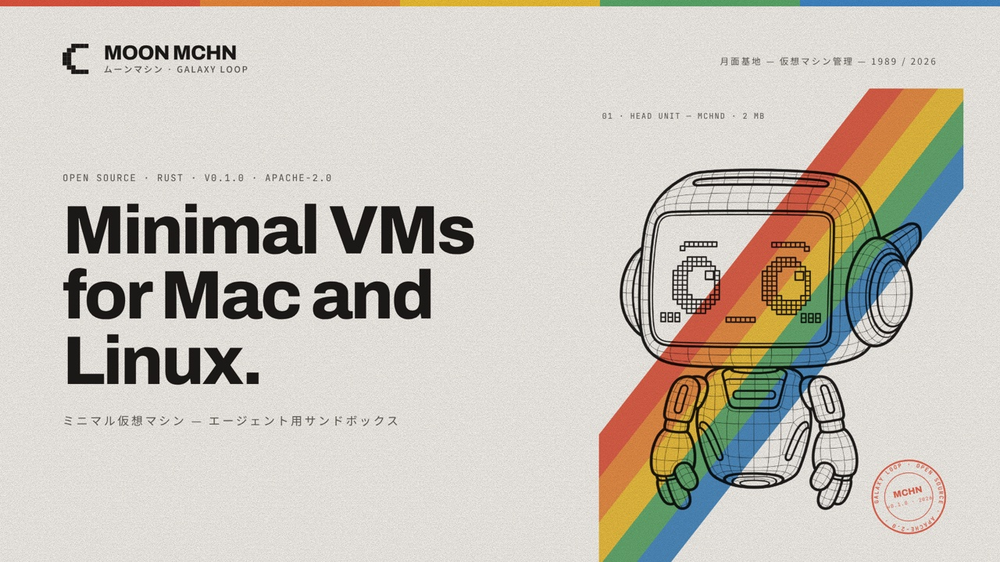

# Moon MCHN (Moon Machine)



[](https://github.com/galaxyloop-labs/moonmchn/actions/workflows/ci.yml)
[](https://github.com/galaxyloop-labs/moonmchn/releases)
[](https://scorecard.dev/viewer/?uri=github.com/galaxyloop-labs/moonmchn)
[](https://www.bestpractices.dev/projects/16520)
[](LICENSE)
[](Cargo.toml)
[](#quick-start)
[](https://github.com/galaxyloop-labs/moonmchn/stargazers)

MicroVMs for the AI era.

Moon MCHN offers VMs to run AI agents and assistants, or to use as a general-purpose development tool.

While we want to provide a secure environment, be aware that Moon MCHN is an early release. Read [CHANGELOG.md](CHANGELOG.md) and [ROADMAP.md](docs/ROADMAP.md) to learn more about the present and the future of this project.

## Why

Attackers now go after developers' machines: a worm in an npm package, malware in the git hooks of a fake job assignment, a prompt injection that steers a coding agent. Moon MCHN runs the code you'd rather not run as yourself in a Linux microVM, on macOS and Linux.

Each machine comes with:

- **Its own kernel.** A microVM with its own Linux kernel, on the host's hardware virtualization. Code inside sees the machine, and your files stay out of its reach.
- **Nothing of yours inside unless you list it.** A fresh configuration shares no host files. You name the directories a machine may see, read-only or writable.
- **Rules on the host.** Resources, mounts and network rules live on the host, out of the machine's reach, so an agent inside cannot switch them off.
- **Pinned images.** A machine boots an OCI image pinned to the digest it resolved to, so the same spec boots the same content. Registry images need no Docker on the host.

## Quick start

You need an Apple Silicon Mac or Linux with KVM (`/dev/kvm`), and Rust 1.99 or later:

```sh
cargo install moonmchn-cli --locked  # installs mchn with the dependency versions the release pinned
mchn setup                           # run once; writes ~/.config/moonmchn/config.toml, sized to this host
mchn daemon start                    # starts the daemon in the background
mchn start dev                       # boots a machine named dev from the official image
mchn shell dev                       # opens a shell in it
mchn exec dev -- uname -a            # runs one command in it
mchn stop dev                        # stops it and discards its disk
mchn --help                          # shows all the commands
```

## What it protects, and what it does not yet

Moon MCHN keeps out of a machine's reach:

- Your files outside the mounts you list: keys, credentials, other projects.
- Services on your host: no machine reaches them, whatever the network rules say.

Not yet:

- **What you hand in.** A mounted directory is the machine's to read and change.
- **The network.** Network rules are still early: in 0.1.0, `setup` starts with every host allowed, for you to narrow, and DNS queries pass unchecked. In a future version, the [egress firewall](docs/ROADMAP.md) will check every connection and DNS query, and deny by default.
- **The VM process.** Under the 0.1.0 engine, the process that runs the VM has your user's permissions, so a guest that escaped the VM would get them. Confining that process with Seatbelt on macOS and Landlock on Linux is next on the [roadmap](docs/ROADMAP.md).

[Known limitations](docs/SPEC.md#known-limitations) lists the rest.

## How it compares

Moon MCHN is made for one developer's own Mac or Linux machine, with two choices at its core, both on the [roadmap](docs/ROADMAP.md):

- **Two walls.** The microVM, and the host process that runs it, confined by the host kernel: Seatbelt on macOS, Landlock on Linux.
- **Machines you can rebuild.** Toolchains come from Nix packs pinned in the machine's spec, so the same spec gives the same machine.

## Development

[DEVELOPMENT.md](docs/DEVELOPMENT.md) covers the repository layout, the Nix setup, the `make` targets, the rules the code holds itself to, and how to verify a release.

## Security

Report vulnerabilities privately through [GitHub's private vulnerability reporting](https://github.com/galaxyloop-labs/moonmchn/security/advisories/new). [SECURITY.md](docs/SECURITY.md) covers what to include, what happens next, and what is in scope.

## License

Licensed under the [Apache License, Version 2.0](LICENSE).
