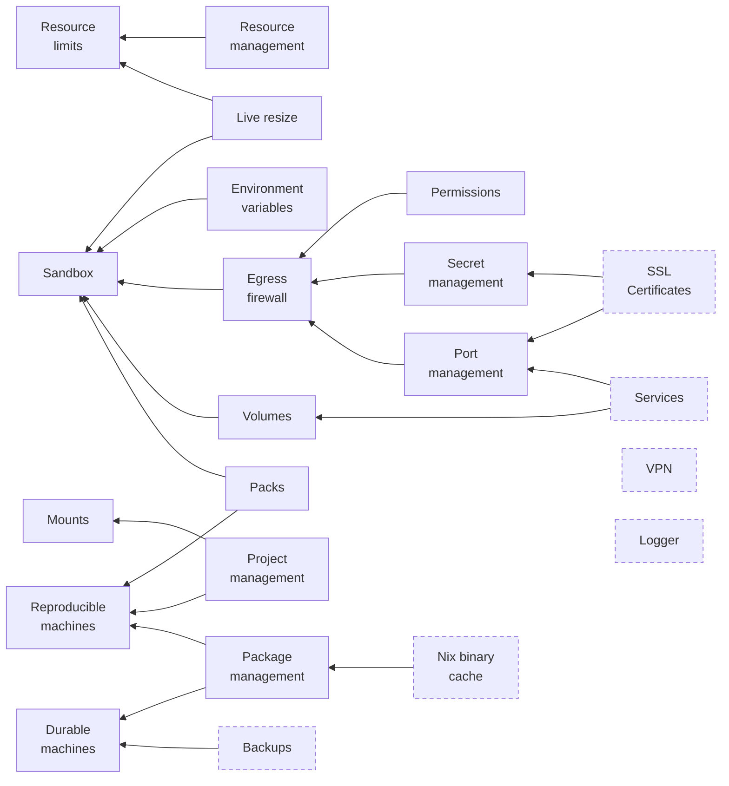

# Roadmap

Read [CHANGELOG.md](../CHANGELOG.md) for what was already built.

## Next

In the order we plan to build them.

- **Durable machines:** a machine keeps its disk across `stop` and `start` by default; `--ephemeral` creates a one-off machine.
- **Mounts:** mount host directories into the VM (read-write or read-only).
- **Sandbox:** the VM process confined by the host kernel, with Seatbelt on macOS and Landlock on Linux.
- **Environment variables:** per machine.
- **Egress firewall:** every outbound connection and DNS query checked against your rules.
- **Port management:** expose ports from the guest to the host.
- **Permissions:** approve what a machine asks for when it first needs it: once, for that machine, or always.
- **Reproducible machines:** the same spec boots the same machine.
- **Packs:** prebuilt OCI layers on top of the default VM for supportring common setups: programming languages, an agent harnesses, AI assistants.
- **Package management:** with Nix.
- **Project management:** team-reproducible machines to share the same development setup.
- **Secret management:** API keys and tokens for machines outside the reach of the agent.
- **Resource limits:** memory, CPU, GPU and more, per machine.
- **Resource management:** rate limits on creating machines, for security and so machines never put your hardware under pressure.
- **Live resize:** grow a running machine's CPUs, memory and disk.
- **Volumes:** storage that outlives a machine.

## Later

In no order yet.

- **Services:** Sidekick, pre-built VMs with a single running service (e.g. Postgres, Redis, etc...).
- **Backups** of a machine's data.
- **Nix binary cache** for faster package installs.
- **SSL Certificates**: Self-signed for local development, or real certificates for deployment.
- **VPN:** a private, encrypted channel between the `mchn` CLI and its daemon, on the same host and, later, to a daemon on another host.
- **Logger:** one logger for every line the daemon writes.

## What builds on what

An arrow goes from an item to what it builds on, so the items others depend on sit on the left. Dashed boxes are the Later items. Several items build on the engine work that Sandbox brings.

